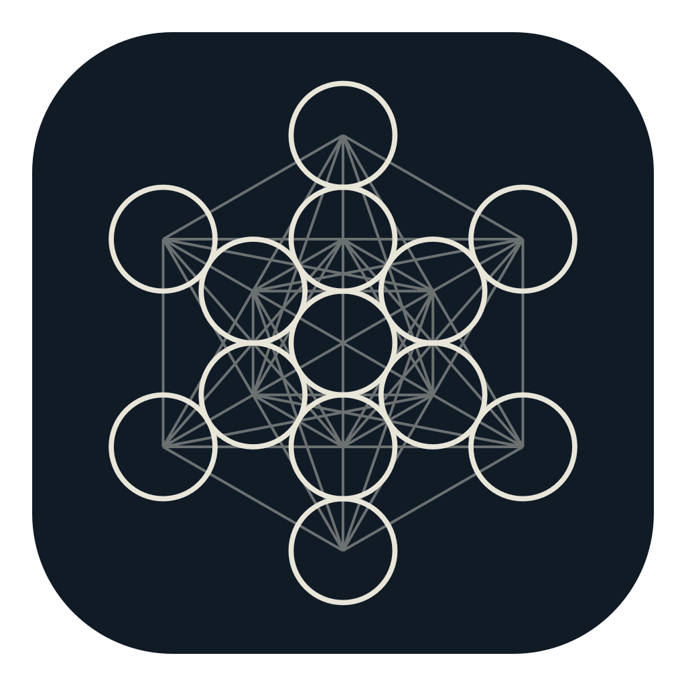
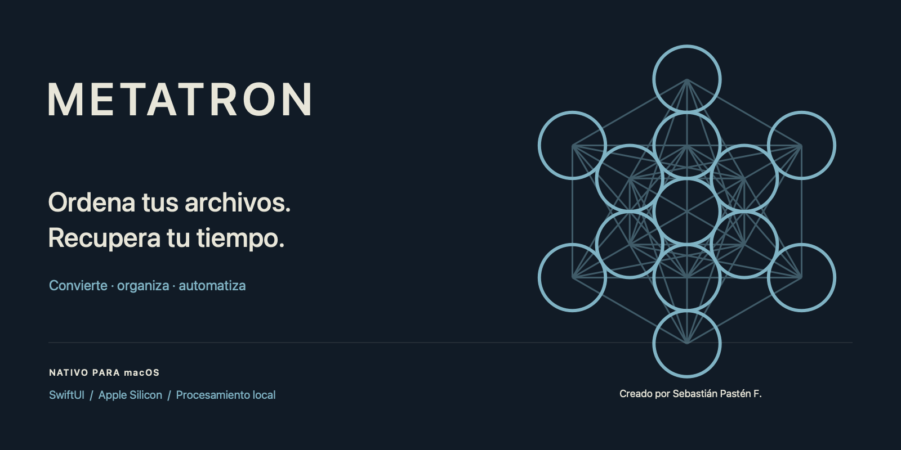
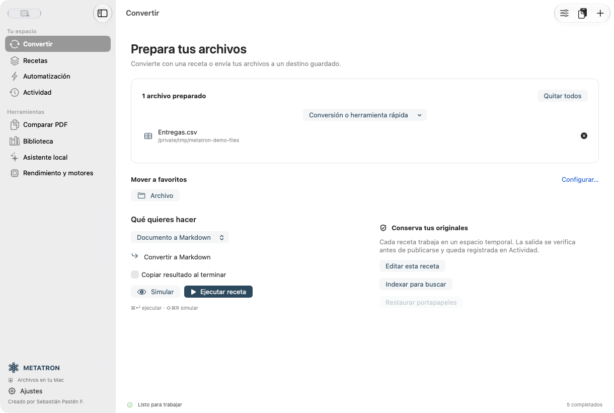
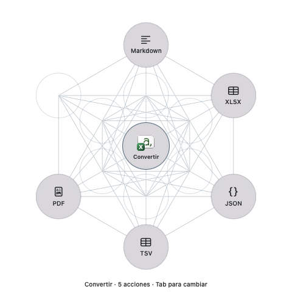
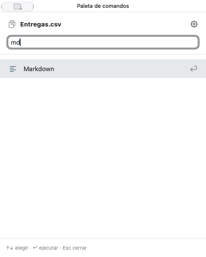
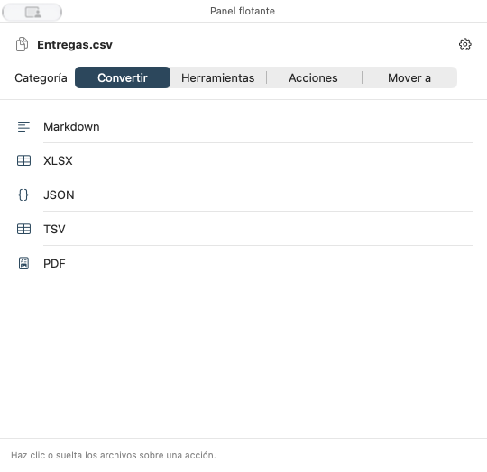
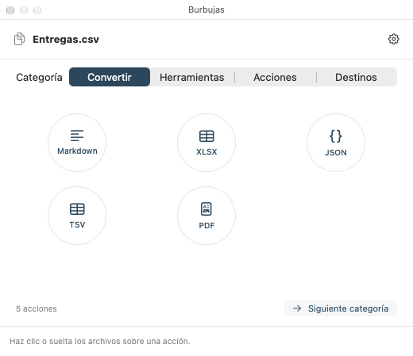

<div align="center">
  
  <h1>METATRON</h1>
  <p><strong>Ordena tus archivos. Recupera tu tiempo.</strong></p>
  <p>Convierte, organiza y automatiza desde una aplicación nativa para macOS.</p>
  <p>
    
    
    
    <a href="LICENSE"></a>
  </p>
  <p><a href="#empezar">Empezar</a> · <a href="#seis-formas-de-trabajar">Presentaciones</a> · <a href="docs/FEATURES.md">Alcance</a> · <a href="docs/COMPARISON.md">Comparativa</a> · <a href="CONTRIBUTING.md">Contribuir</a> · <a href="https://ko-fi.com/C0C51WQ1T0">Apoyar</a></p>
</div>



**METATRON** reúne conversiones de archivos, recetas de varios pasos, carpetas favoritas y una cola con resultados verificables. Su identidad parte del cubo de Metatrón: círculos y conexiones, con una interpretación gráfica propia y sin figuras antropomórficas.

**Creado por Sebastián Pastén F.** Construido sobre [Kumquat](https://github.com/iandifilippo/Kumquat), bajo MIT, e inspirado en el flujo de trabajo de Tangerine. Se conserva la atribución de la base en [UPSTREAM.md](UPSTREAM.md).

## Mejoras respecto a Kumquat y Tangerine

METATRON amplía la base MIT de Kumquat con un espacio de trabajo, recetas encadenadas, destinos predefinidos, actividad exportable y publicación de salidas con hashes y recibos. Tangerine es la referencia del gesto contextual; su código propietario no forma parte del proyecto.

La [comparativa con Kumquat, Tangerine y las versiones anteriores](docs/COMPARISON.md) distingue funciones heredadas, mejoras propias y limitaciones. El procesamiento local, OCR y Markdown no se presentan como novedades exclusivas.

**Versión actual: [METATRON 2.2.0](https://github.com/AD0441/METATRON/releases/tag/v2.2.0), para Apple Silicon.** Incluye recetas contextuales, procesamiento documental y segundo plano. Consulta el [historial de cambios](CHANGELOG.md) y la comparativa; las acciones nativas de Atajos permanecen bloqueadas en esta compilación con firma ad hoc, sin Team ID Apple.

La rama de mantenimiento prepara **2.2.1**. Su alcance, pruebas y pendientes están en el [informe de estabilización](docs/STABILITY-2.2.1.md); la release pública continúa siendo 2.2.0.

## En uso

Las imágenes siguientes son capturas de la aplicación con archivos sintéticos de demostración.



| Cubo de Metatrón | Paleta de comandos |
| --- | --- |
|  |  |

| Panel flotante | Burbujas |
| --- | --- |
|  |  |

## Qué puedes hacer

- **Convertir** imágenes, PDF, documentos, datos, audio, vídeo, subtítulos y archivos comprimidos, según el formato y los motores disponibles.
- **Exportar Markdown** desde PDF, imágenes con OCR, documentos, tablas y subtítulos. También desde recetas y terminal.
- **Guardar recetas**: combinar pasos, calidad, tamaño, metadatos, sufijo y destino. Simular antes de ejecutar.
- **Organizar** con carpetas favoritas: un clic para mover, resolver nombres repetidos y deshacer el último movimiento.
- **Revisar Actividad**: buscar, filtrar, exportar y limpiar registros; conservar todo, 7, 14 o 30 días. Limpiar el historial conserva los archivos.
- **Trabajar con PDF**: comparar páginas visualmente, organizar, dividir, unir, proteger y producir copias rasterizadas con términos retirados.
- **Usar herramientas locales**: OCR y sujetos con Vision; asistente de Apple Intelligence cuando el sistema lo declara disponible.

Consulta la [matriz de funciones y límites](docs/FEATURES.md). La conversión de documentos complejos y tablas OCR requiere revisar el resultado; no se promete fidelidad universal.

## Seis formas de trabajar

Elige en **Ajustes → General → Presentación**. Todas comparten las acciones y los destinos configurados.

| Presentación | Para qué sirve |
| --- | --- |
| **Cubo de Metatrón** | Círculos flotantes sobre el entorno, con el archivo en el centro y las conexiones geométricas. Sin marco, barra de título ni fondo rectangular. |
| **Ruleta clásica** | Sectores radiales para quienes prefieren el gesto tradicional. |
| **Menú compacto** | Acciones agrupadas en una lista, con nombres completos. |
| **Panel flotante** | Pestañas de conversión, herramientas, acciones, destinos, recetas y documentos. |
| **Paleta de comandos** | Buscar `md`, `Markdown`, un formato, una herramienta o una carpeta y pulsar Enter. |
| **Burbujas** | Burbujas distribuidas en órbita alrededor del archivo y del cursor, sobre una superficie transparente. |

En la ventana, **Acciones** o **⌘K** abre la presentación elegida. También puedes usar «Abrir con», la barra de menús y la selección de Finder. macOS puede pedir permiso para leer esa selección cuando usas el atajo.

Durante un arrastre, los modificadores permiten abrir las categorías:

| Tecla | Categoría |
| --- | --- |
| **Shift** — o el disparador elegido | Convertir; nuevas pulsaciones recorren categorías |
| **Command** | Herramientas |
| **Control** | Acciones de archivos |
| **Option** | Destinos favoritos |
| **Control + Option** | Destinos incluso si Option es el disparador principal |

El cubo, Burbujas y la ruleta muestran hasta doce acciones por categoría. En los tres, pulsa el centro, Tab o espacio para cambiar de categoría; Escape o un clic fuera los cierra. El círculo central muestra el icono del archivo. Solo los círculos de acción aceptan el archivo soltado; los huecos entre ellos no activan operaciones. Las listas y la paleta permiten buscar las acciones disponibles de las seis familias. Los iconos tienen ayuda contextual con el nombre completo.

## Recetas, documentos y automatización

Ejecuta tus recetas desde los círculos de **Recetas** y **Documentos**, desde la CLI. También se incluyen tres acciones App Intents para Atajos: aparecen en su buscador, pero **esta compilación ad hoc no puede ejecutarlas porque carece de un Team ID Apple**. La ejecución nativa debe validarse tras firmar con una identidad Apple. «Preparar para la web» y «Documento para análisis» son secuencias explícitas que puedes editar; no necesitan un modelo de lenguaje.

La simulación muestra el peso de entrada, resolución y posibles pérdidas. Actividad muestra los tamaños reales después de verificar las salidas. El procesamiento documental incluye OCR, Markdown con procedencia, imágenes raster incrustadas compatibles y combinación de imágenes, PDF y documentos en un PDF final. MarkItDown y Docling son motores opcionales configurables: consulta [Documentos](docs/DOCUMENTS.md) y los [límites de la versión](docs/PREPUBLICATION.md).

## Barra superior y segundo plano

METATRON mantiene **una sola instancia**. Cerrar la ventana conserva la app en la barra de menús. Su símbolo permite abrir la ventana, acceder a Recetas o Actividad, pausar automatizaciones, ocultar o mostrar el Dock, abrir Ajustes y **salir completamente**. «Dejar en segundo plano» oculta ventana y Dock; «Iniciar en segundo plano» controla el próximo inicio. La integración utiliza la barra de menús de macOS, junto a los controles del sistema.

Pausar detiene los nuevos accesos contextuales y la recepción de carpetas vigiladas. El trabajo ya activo termina su paso; no se borran originales.

## Apariencia y organización

Cinco paletas sobrias: **Petróleo, Bosque, Grafito, Pizarra y Burdeos**. Las superficies y el texto usan colores semánticos del sistema; el acento se adapta a claro y oscuro.

En **Ajustes → Organización**, añade carpetas, ponles nombre y ordena tus favoritos. Los resultados de una conversión se guardan junto al original en una subcarpeta Metatron, o en el destino de la receta. La publicación verifica salidas, crea hashes y evita reemplazar archivos existentes. Los originales se conservan durante las conversiones; **Mover** es una acción explícita distinta.

Deshacer una salida comprueba que no haya cambiado y la archiva para recuperación. La limpieza o caducidad de un registro retira su acceso a Deshacer, sin borrar archivos. Los movimientos guardan un registro reversible del último traslado.

## Empezar

[Descargar METATRON para Apple Silicon](https://github.com/AD0441/METATRON/releases/latest) · [Compilar desde el código](#empezar)

Requiere macOS 14+ y Xcode con Swift 6.2 o posterior para compilar. La validación local se realizó en un M1 de 8 GB con Swift 6.4. Las acciones de archivos de Atajos requieren macOS 15+. Apple Intelligence requiere macOS 26+ y disponibilidad del modelo en el sistema.

```sh
git clone https://github.com/AD0441/METATRON.git
cd METATRON
./script/build_and_run.sh
```

El script crea **`dist/METATRON.app`** con **`metatron-cli`** dentro del paquete, con compilación release y firma local ad hoc. El proyecto Xcode genera los metadatos de App Intents; SwiftPM mantiene el núcleo, la CLI y las pruebas. La compilación usa una copia temporal para evitar bloqueos de coordinación de Escritorio/iCloud. Usa Xcode mediante `DEVELOPER_DIR` sin cambiar la configuración global. La firma local no equivale a notarización de Apple.

```sh
./script/test.sh
./script/build_and_run.sh --verify
./dist/METATRON.app/Contents/MacOS/metatron-cli convert archivo.pdf --to md
./dist/METATRON.app/Contents/MacOS/metatron-cli simulate foto.png --to jpg
./dist/METATRON.app/Contents/MacOS/metatron-cli engines
```

FFmpeg, WebP, LibreOffice y Ghostscript amplían algunas rutas. Se detectan localmente; METATRON no los descarga automáticamente. El envío LAN actual ofrece un enlace HTTP temporal: úsalo en una red de confianza; todavía no implementa el protocolo cifrado de LocalSend.

Las instalaciones previas de Citrino pueden copiar sus preferencias y espacio de trabajo al primer inicio; se conserva la copia anterior.

## Apple Silicon: medir antes de acelerar

SwiftUI/AppKit, ImageIO, PDFKit, AVFoundation y Vision forman la base nativa. Core Image comparte un contexto Metal; la cola limita el trabajo pesado a una tarea simultánea y usa lectura por bloques para hashes y transferencias.

La reducción simple de imágenes usa Core Graphics porque fue más rápida que la ruta Metal ensayada en el M1. No se fuerza la GPU para operaciones donde añade coste.

En un PDF sintético de 24 páginas, la imagen larga pasó de **524 MB a 117 MB** de memoria residente máxima y de **2,52 a 1,18 segundos**. La nueva ruta dibuja en un solo lienzo limitado a **24 megapíxeles y 32.000 px de alto**. Su resolución es menor: esta medición no compara la misma cantidad de píxeles ni representa el rendimiento de toda la aplicación. [Datos y límites de medición](docs/performance-pdf-m1.json).

Vision y macOS deciden el uso del hardware. No se afirma disponer de un modelo propio entrenado ni una ejecución garantizada en Neural Engine.

## Contribuir

Los aportes son bienvenidos: [errores y propuestas](https://github.com/AD0441/METATRON/issues), pruebas con formatos reales anonimizados, accesibilidad, traducciones y rendimiento medido. Consulta [CONTRIBUTING.md](CONTRIBUTING.md) y [CODE_OF_CONDUCT.md](CODE_OF_CONDUCT.md).

Antes de integrar motores adicionales, revisamos coste de memoria, distribución, licencia y fidelidad. Las siguientes propuestas están en [IDEAS.md](docs/IDEAS.md): reglas de organización, renombrado por lotes, vista previa y extracción estructural opcional.

## Apoyar el proyecto

Los aportes voluntarios ayudan a mantener el desarrollo y las pruebas de METATRON.

[](https://ko-fi.com/C0C51WQ1T0)

## Identidad y licencia

El símbolo, los iconos de documentación y la portada se generan con geometría original. Se incluyen SVG, PNG, ICNS y el [generador reproducible](script/make_brand.swift). La imagen aportada por el usuario se utilizó como referencia visual y no se redistribuye. [Criterios de identidad y referencias](docs/BRAND.md).

MIT. Se mantiene el copyright de Kumquat y se identifican los aportes de METATRON. No existe afiliación con Tangerine, Apple o los proyectos citados.

<div align="center">
  <picture><source media="(prefers-color-scheme: dark)" srcset="docs/assets/brand/symbol-dark.svg"></picture>
  <p><strong>Creado por Sebastián Pastén F.</strong></p>
</div>
